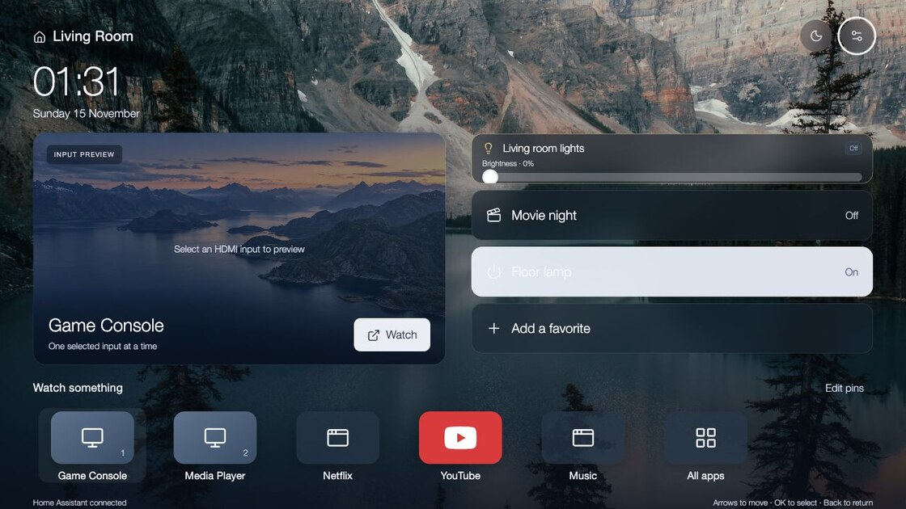

# Luma Home

Put your apps, HDMI inputs, and Home Assistant controls on one screen on a rooted LG webOS TV.

## Features

- **Launcher and quick panel.** Pin TV apps and HDMI inputs. Open a compact panel over what you’re watching, or open the full launcher.
- **Home Assistant controls.** Dim lights, run scenes and scripts, and show room temperature and humidity.
- **Voice on the TV remote.** Use tap-to-speak or hold-to-speak with Home Assistant Assist and hear the reply on the TV.
- **Overlays.** Show a camera feed, a text notification, or a spoken announcement over the current picture.
- **Personalize the TV.** Set a backdrop, rename HDMI inputs, and display an idle clock.

## Install

1. On the TV, open **Homebrew Channel → Settings → Add repository** and enter the [Homebrew catalog URL](https://raw.githubusercontent.com/vibribbonee/arcguard/main/repo.json). Install **Luma Home** and **Luma Camera Overlay**, or download both [IPKs from Releases](https://github.com/vibribbonee/luma-home-webos/releases/latest).
2. Add your TV to Home Assistant with the built-in **LG webOS TV** integration. Install Luma Home from Marketplace, restart Home Assistant, then add the **Luma Home** integration and select the TV.
3. In Home Assistant, add `/luma_home/luma-home-card.js` as a JavaScript module dashboard resource. Add a card with `type: custom:luma-home-settings`. With the TV on, open the card and select **Pair TV with this Home Assistant**.
4. On the TV, open **Luma Home → Settings → System & voice** and enable **Home button shortcut**. Tap Home for the quick panel or hold it for the full launcher. You can swap the two actions in the same menu.

Tested on LG UP78 (43UP78006LB), webOS 6.3.2-425.

## Use it with Home Assistant

- **Voice** — Turn on **Home Assistant microphone** in **System & voice** and choose an Assist pipeline on the Luma Home device page.
- **Notifications** — Use `luma_home.notify` for a text overlay or `assist_satellite.announce` for a spoken announcement with text.
- **Cameras** — Use `luma_home.show_camera` with a camera entity to show a timed overlay.

[Home Assistant actions](custom_components/luma_home/services.yaml) · [Wallpaper credits](src/com.spinoff.lumahome/licenses/wallpapers.txt) · [Icon and library credits](vendor/README.md)

## Contributing

Pull requests are welcome. Describe the change and how you tested it.

[MIT license](LICENSE). OpenAI Codex assisted with development, testing, and documentation.
